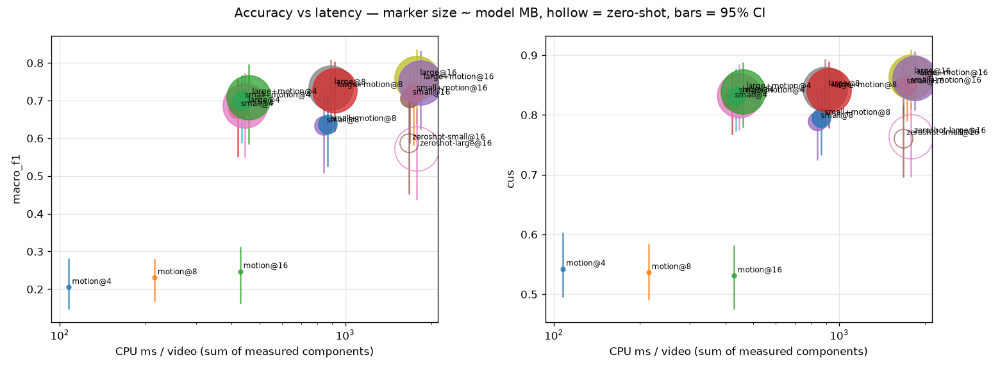
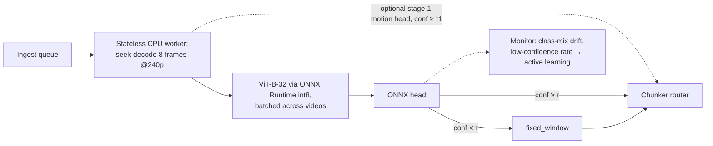

# Video-type classifier for chunker routing (CPU-only POC)

**Recommendation: `large@8`** (ViT-B-32 on 8 frames + logistic head): macro-F1 0.735, CUS 0.843, 891 ms/video, 351 MB (image tower). **Lightweight alternative: `small@4`** (MobileCLIP2-S0 on 4 frames): 47% of the latency and 1/7.7 of the size for −0.057 macro-F1 and −0.019 CUS, the CIs overlap (unpaired). Numbers come from `artifacts/eval_results.json`, `benchmark.json` and `features/timings.json`.

## 1. Taxonomy and data

| Class | Chunker | Visual signature (typical VideoMME source) |
|---|---|---|
| gameplay_animation | shot_boundary | synthetic colours, HUDs, hard cuts (Esports, Animation) |
| sports_broadcast | motion_segment | fields or courts, fast pans, score bugs (Football, Basketball) |
| vlog_egocentric | activity | handheld, first-person, one continuous scene (Daily Life, Travel) |
| talking_head | speaker_turn | static framed face (News, interviews) |
| presentation_screen | slide_change | static slides or screens (Knowledge) |
| cinematic_documentary | semantic_scene | graded footage, B-roll, varied scenes (Film & TV, Documentary) |

Each class calls for a different chunker and occurs in VideoMME. **Sample:** stratified 10% (90 of 900 videos; 30 short/30 medium/30 long; duration × domain, seed 42); 9 unavailable videos were replaced by same-stratum spares.

**Labels:** sub-category defaults, then a 4×4 contact-sheet review per video changed 27/90 (agreement 0.70). Final support: cinematic 35, vlog 22, gameplay 11, talking_head 9, sports 8, presentation 5.

## 2. Feature engineering

**Frame sampling.** I seek-decode 16 timestamps spread uniformly over the video, skipping the first and last 5%, at 240p (23.4 ms per timestamp). Seeking makes cost independent of video length; 4/8-frame configs use evenly spaced subsets.

**Motion features.** At each timestamp, a burst of 8 grayscale 64×64 frames, 0.25 s apart, gives 13 model-free features (3.4 ms per timestamp): motion energy (mean/std/max), hard-cut rate, camera shake (`phaseCorrelate` shift mean/std), static fraction, scene diversity, brightness (mean/std), saturation, edge density and colourfulness. A per-frame image encoder cannot see these.

**Frozen encoders.** I use the image towers of MobileCLIP2-S0/dfndr2b (45 MB) and ViT-B-32/laion2b_s34b_b79k (351 MB; the full CLIP checkpoint downloaded is about 605 MB, and its text tower is unused at serve time). Each 512-d embedding is pooled as mean ⊕ std over frames. The head is a class-balanced logistic regression: 33 KB of parameters (41.5 KB as ONNX).

## 3. Results

Stratified 5-fold CV × 5 repeats; brackets are 95% bootstrap CIs.



| Config | macro-F1 [CI] | CUS [CI] | ms/video | MB |
|---|---|---|---|---|
| motion@4 | 0.205 [0.147, 0.282] | 0.542 [0.495, 0.603] | 108 | 0.0004 |
| **small@4** (lightweight) | 0.677 [0.550, 0.756] | 0.824 [0.767, 0.871] | 420 | 45.5 |
| small@16 | 0.707 [0.587, 0.772] | 0.847 [0.794, 0.890] | 1678 | 45.5 |
| **large@8** (chosen) | 0.735 [0.622, 0.809] | 0.843 [0.780, 0.894] | 891 | 351.4 |
| large@16 (best) | 0.759 [0.638, 0.837] | 0.864 [0.810, 0.910] | 1782 | 351.4 |
| zero-shot large@16 | 0.572 [0.436, 0.679] | 0.764 [0.697, 0.821] | 1781 | 351.4 |

**Operating point.** The rule picks the fastest config within 0.03 macro-F1 of the best (large@16). This rule optimises latency at near-best accuracy; if weight size or download dominates (edge, tight memory), `small@4` (45 MB, 420 ms) is the drop-in alternative via one config change, and `large@4` (446 ms, F1 0.687) is the latency-matched point. τ = 0.0 (fallback off): no threshold gave ≥90% accuracy at ≥50% coverage; τ = 0.5 gives 0.828 accuracy at 71% coverage, τ = 0.9 gives 0.905 at 23%.

**Lightweight trade-off.** small@4 halves latency and is 7.7× smaller for about 2 CUS points. At batch 16 on this CPU both encoders cost about 55–57 ms/frame, so its speed comes from using 4 frames; the small encoder's benefit is weight size.

**Per-class F1** (confusion matrix: `artifacts/eval_results.json` → `configs["large@8"].detail.confusion`; one repeat's out-of-fold predictions, operating point): sports 0.94, gameplay 0.87, cinematic 0.73, presentation 0.73, vlog 0.71, talking_head 0.46. Of the 9 talking heads, 4 were predicted cinematic and 2 vlog, plausibly because location interviews look like B-roll.

**Other findings.** The trained head beats zero-shot CLIP (0.57–0.59) by about +0.15 macro-F1. Proxy labels cost about 0.18 macro-F1: training on the unreviewed labels gives 0.550 [0.440, 0.634] (not a controlled swap). Motion features alone reach only 0.21–0.25, and on top of embeddings change macro-F1 by −0.011 to +0.023, within the CI.

## 4. Custom metric: Chunking Utility Score (CUS)

Not all routing errors cost the same. A talking head sent to the slide chunker keeps a transcript-aligned chunker; one sent to the motion chunker does not.

U (`artifacts/utility.csv`, an assumption to calibrate against per-class retrieval recall) is the fraction of chunking quality kept when a video of class `true` is routed as `pred`: 1.0 on the diagonal, 0.7 gameplay ↔ sports, 0.6 talking_head ↔ presentation, 0.5 vlog ↔ cinematic, 0.2–0.4 elsewhere. **CUS** is the mean of U[yᵢ, ŷᵢ] over videos.

**Expected-utility rule.** The rule ŷ = argmaxₖ Σⱼ p(j)·U[j,k] changes CUS by only +0.0042 at large@8, and by −0.003 to +0.004 across the embedding configs. U is strongly diagonal-dominant and the head is confident, so production uses argmax.

## 5. Deployment (on paper)



Workers are stateless and scale horizontally; monitoring tracks class-mix drift and the low-confidence share (29% below 0.5 here) for active learning. The optional motion-only stage 1 never matched stage-2 accuracy here (stop fraction 0.0), so expected cost stays 891 ms/video; int8 was not measured. Measured end-to-end (batch 1, 3 demo clips): p50 598.8 ms, p95 612.5 ms (decode 168 ms, encoder 430 ms).

**Cost at 100M videos** (worker-hours; one worker = one pipeline process on the 16-logical-core benchmark machine): 891 ms → 24,758 h, 1,032 workers for a 24 h turnaround. At the measured batch-32 throughput (1.68 videos/s): 16,521 h, 689 workers; small@4: 11,669 h, 487 workers.

## 6. Limitations and how to reproduce

**Limitations.** n = 90 gives CIs of about ±0.1, so most encoder differences are within noise (presentation has 5 videos, talking_head 9). Labels are proxies corrected by one contact-sheet review (Claude proposed, the user confirmed). Label overrides were made from the same 16 frames the encoders see, which may favour image models and inflate the reviewed-vs-proxy gap. U is assumed. τ, τ1 and the operating point were tuned on the same out-of-fold predictions they are scored on. No audio (CLAP would help talking_head vs presentation). Per-frame latencies are single-frame and include PIL preprocessing; batched serving is lower (see `benchmark.json`). Committed artifact numbers come from the author's machine (`evaluate`/`benchmark` rewrite them with the grader's). Latency comes from one Windows 11 machine (AMD64 Family 25 Model 80, 16 logical cores, CPU only).

**Run** (from `run.yaml`; requires Python 3.12+, CPU only):

```bash
pip install -r requirements.txt
python src/main.py fetch-encoder
python src/main.py evaluate
python src/main.py predict samples/
python src/main.py benchmark samples/
python -m pytest -q
```

**Full rebuild:** `python src/main.py <step>` for `sample → download → extract → label-sheets → labels → featurize → evaluate → export`; before `labels`, review the sheets and record corrections in `artifacts/label_overrides.csv`.
